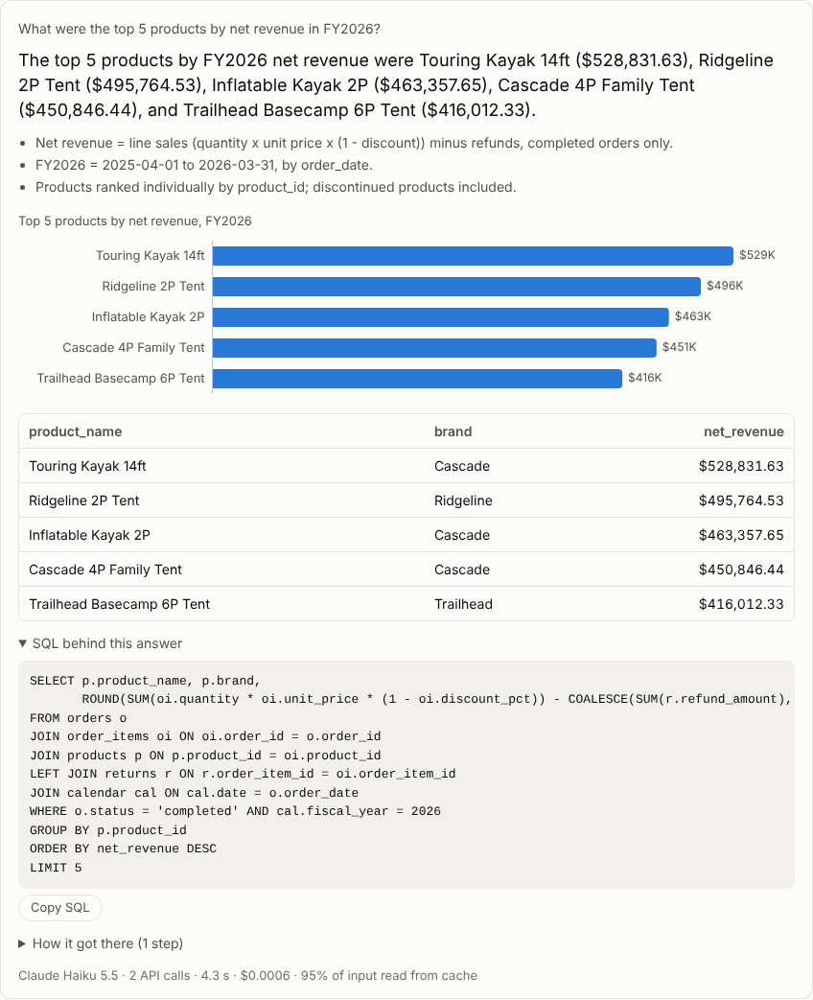
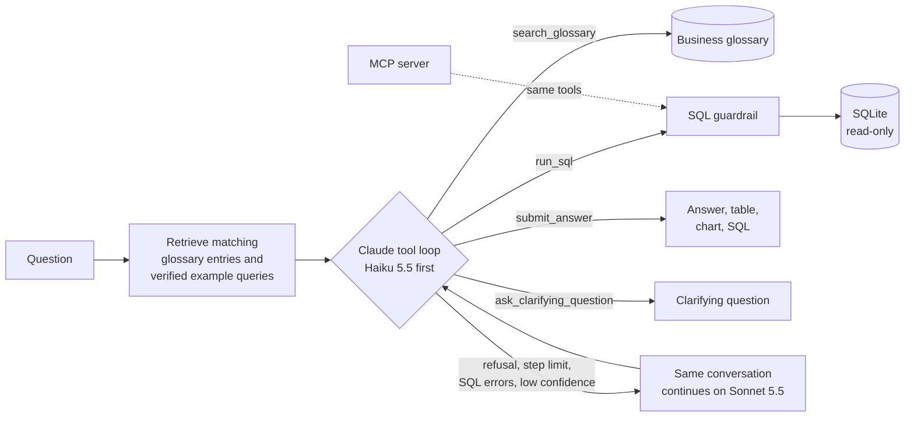
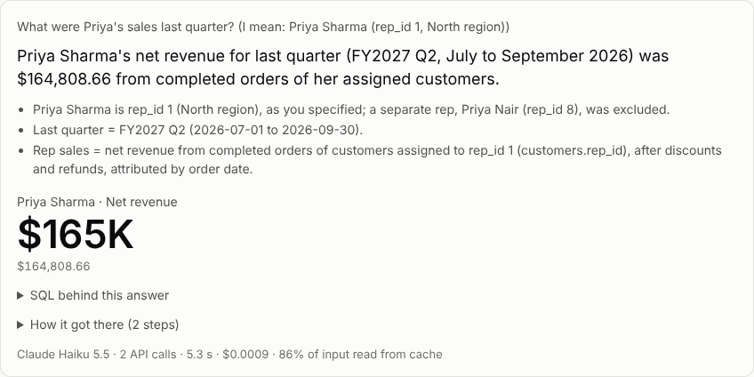
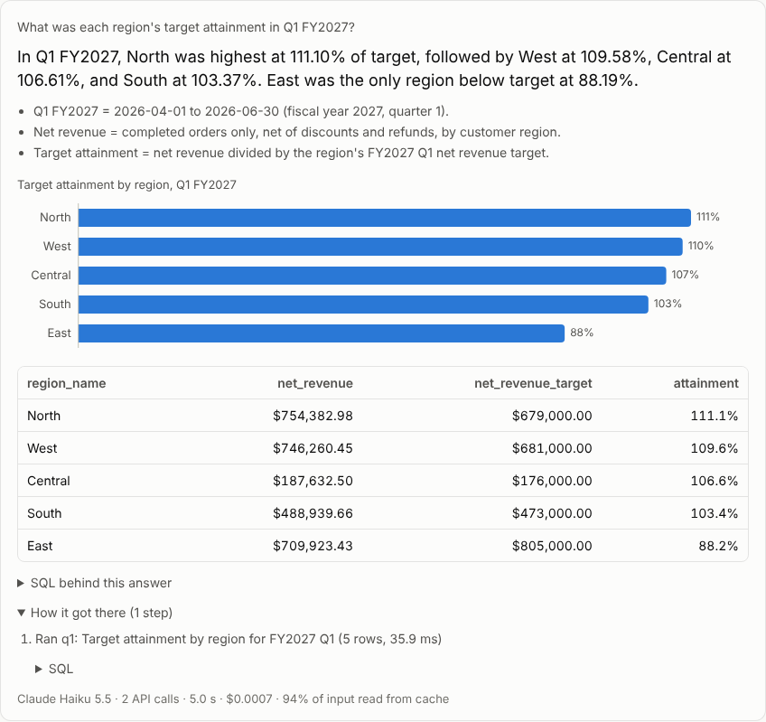

# Ask your data

[](https://github.com/surendrallam/ask-your-data-agent/actions/workflows/ci.yml)

A Claude agent that answers plain-English business questions over a sales database. It writes read-only SQL, applies the company's metric definitions, asks a clarifying question when a request is ambiguous, and shows its work: the answer, the result table, a chart and the exact SQL.

It ships with a **50-question benchmark** that compares Claude Haiku 5.5, Sonnet 5.5 and Opus 5.5 on accuracy, cost and latency, plus an auto mode that starts on Haiku and escalates to Sonnet only when a question proves hard.

> **Results (2 Nov 2026, 3 runs of all 50 questions):** Sonnet 5.5 and Opus 5.5 answered every question correctly in all three runs. Haiku 5.5 scored 96.7% at about 1/14 of Sonnet's cost per question. Details in [Results](#results).



A 75-second captioned demo is in [`docs/media/demo.mp4`](docs/media/demo.mp4).

## What it does

- **Plain English in, numbers out.** "What were the top 5 products by net revenue in FY2026?" returns a one-line answer, the rows, a bar chart and the SQL that produced them.
- **Governed metrics.** A business glossary defines net revenue, active customers, churn, CAC, gross margin, target attainment and more (`data/glossary.yaml`). The agent retrieves the definitions that match each question and must use them, so "revenue" means the same thing every time.
- **Asks instead of guessing.** If a name matches two people or accounts, a question asks for "best" without a measure, or a month has no year, it asks a short clarifying question with options.
- **Read-only by construction.** SQLite enforces the guardrail, not string matching: see [Guardrail](#guardrail).
- **Cost-aware model routing.** Auto mode answers on Haiku 5.5 and hands the same conversation to Sonnet 5.5 after a refusal, a step limit, three SQL errors or a low-confidence answer.
- **Prompt caching.** The tools, instructions, schema and core definitions form one cached prefix; the growing conversation is cached automatically.
- **MCP server.** The same guarded tools work in Claude Desktop or any MCP client.
- **Web UI and CLI.** A single-page UI (light and dark, phone and desktop) and an `askdata` command.
- **Spend controls.** Every API call is logged to `runs/costs.csv` with its tokens, cost and latency. Before each call, its worst case is checked against a budget (`ASKDATA_BUDGET_USD`, default $85) and the call is refused if it could pass it.

## How it works



1. The question arrives with the three glossary entries and two verified example queries that best match it (BM25 retrieval over `data/glossary.yaml` and `data/examples.yaml`).
2. Claude explores with `search_glossary` and `run_sql`. Each query result gets an id (`q1`, `q2`, ...).
3. It finishes with `submit_answer`, citing the id of the query behind the numbers, or with `ask_clarifying_question`. Citing a query id makes every answer traceable: the UI shows that exact table and SQL.
4. In auto mode, a struggling Haiku run is handed to Sonnet with an operator note. The history is append-only, so Sonnet sees Haiku's queries and results and the cache stays valid.

The agent uses the Claude API directly (`anthropic` Python SDK) with a manual tool loop, strict tool schemas, adaptive thinking at `medium` effort, and server-side refusal fallback on Sonnet and Opus.

## Guardrail

All of it is enforced by SQLite:

1. The database file is opened read-only (`mode=ro`) with `PRAGMA query_only`.
2. An authorizer allows only reads (SELECT, column reads, safe functions). Writes, schema changes, `ATTACH`, `PRAGMA` and `load_extension` are denied.
3. Only one statement per call.
4. Queries stop after 5 seconds.
5. At most 1,000 rows come back; the model sees the first 50.

`tests/test_guardrail.py` tries 13 attacks, including stacked statements and DML hidden in a CTE.

## The sample data

Trailhead Goods is a fictional online outdoor-gear retailer. `askdata/seed.py` generates the database deterministically: about 9,450 customer accounts, 30,800 orders, 59,000 order lines and 2,000 returns from April 2024 to September 2026, plus regions, sales reps, quarterly targets and monthly marketing spend. The data has seasonality, a product launch, a promo campaign, a regional shipping problem, and the ambiguous names the clarification tests need. Every row is synthetic.

"Today" is fixed at 2026-10-01 so relative questions ("last quarter", "active customers") have stable answers. Fiscal years run April to March.

## Benchmark

`bench/questions.yaml` holds 50 questions: 45 answerable ones and 5 that should get a clarifying question.

| Group | Examples |
|---|---|
| Basics | totals, counts, a list price, cancelled orders |
| Time logic | fiscal quarters, year to date, trailing twelve months, year-over-year growth |
| Rankings | top products, best department, top customers and reps |
| Governed metrics | active customers, AOV, gross margin, return rate, on-time rate, attainment, CAC, churn, repeat rate |
| Multi-step | biggest grower, best product per department, revenue by acquisition channel |
| Clarification | two reps named Priya, two "Summit Supply" accounts, "Apex" as a customer and a brand, "best" with no measure, a month with no year |

**Grading is by execution, not wording.** The SQL the agent cites is re-run and its rows are compared with the reference SQL's rows: counts must match exactly, money within 0.01%, and rates within 0.06 percentage points (as a fraction or a percentage). Extra columns are fine and order matters only where the question implies it. Asking a clarifying question on an answerable question counts as a miss. The grader's own tests show that common mistakes fail: counting cancelled orders, skipping refunds, using the calendar year instead of the fiscal year.

Cost uses Anthropic's list prices (USD per million input / output tokens, checked 2 Nov 2026): Haiku 5.5 $0.10 / $0.50, Sonnet 5.5 $2 / $10, Opus 5.5 $4 / $20. Cache reads cost 0.1x input (0.05x on Opus 5.5) and cache writes 1.25x.

```bash
python -m bench.run --dry-run                                   # check the reference answers, no API calls
python -m bench.run --configs haiku,sonnet,opus,auto --budget 40
```

The runner resumes where it stopped and writes `results.jsonl`, `summary.json` and `summary.md` to `bench/results/<date>/`. `--budget` is enforced twice: no new question starts once it is reached, and no API call starts if its worst case could pass it. Every call is also logged to `runs/costs.csv`.

## Results

Run on 2 Nov 2026: all 50 questions, 3 runs each, adaptive thinking at medium effort, prompt v2. That makes 600 graded runs, which cost $4.59 in total.

| Model | Accuracy (150 runs) | Right in all 3 runs | $ per question | $ per 1,000 questions | Median / p90 latency |
|---|---|---|---|---|---|
| Claude Haiku 5.5 | 96.7% | 47 of 50 | $0.0007 | $0.67 | 4.7 s / 7.4 s |
| Claude Sonnet 5.5 | **100%** | 50 of 50 | $0.0096 | $9.57 | 4.5 s / 6.4 s |
| Claude Opus 5.5 | **100%** | 50 of 50 | $0.0197 | $19.70 | 7.2 s / 10.9 s |
| Auto (Haiku first, Sonnet if needed) | 97.3% | 48 of 50 | $0.0006 | $0.64 | 4.2 s / 6.9 s |

What the runs showed:

- **The first run's misses were about the shape of the answer, not the reasoning.** In run 1 (prompt v1), 7 of the 9 misses had the right figure inside a wider table, such as every segment's share when the question asked for Enterprise's. One added instruction, "finish with a query that is exactly the answer", took Sonnet from 94% to 100% and Opus from 98% to 100%. Run 1 is kept in `bench/results/2026-11-02/`.
- **Haiku's misses are systematic, not random.** "Show me the sales trend for Apex" matches both a customer and a product brand: Haiku picked the brand in all six of its runs (Haiku and auto mode) instead of asking. Its other misses were the table-shape kind: twice a product lookup and once a breakdown, instead of the exact answer.
- **Confidence-based escalation never fired.** Haiku never rated itself low-confidence, even on its misses, so auto mode behaved like Haiku. Self-reported confidence was a weak routing signal on this workload. A targeted check, such as "does this name match more than one kind of entity?", would catch the main miss more cheaply than switching models.
- **Caching carries the cost.** 92-95% of input tokens were cache reads, and a typical question took two API calls: one query, then the answer.

### How much thinking each model needs

The same 50 questions, 3 runs each, at low and high effort (900 more runs, $8.80). The medium column is run 2. Each cell shows accuracy · cost per question · median latency.

| Model | Low | Medium | High |
|---|---|---|---|
| Claude Haiku 5.5 | 96.0% · $0.00055 · 4.2 s | 96.7% · $0.00067 · 4.7 s | 98.0% · $0.00079 · 5.2 s |
| Claude Sonnet 5.5 | 98.0% · $0.0092 · 4.4 s | 100% · $0.0096 · 4.5 s | 100% · $0.0103 · 4.9 s |
| Claude Opus 5.5 | 100% · $0.0174 · 6.5 s | 100% · $0.0197 · 7.2 s | 100% · $0.0204 · 7.1 s |

- **Opus 5.5 was perfect even at low effort**, which was also its cheapest and fastest setting.
- **Clarification is the first thing to go when thinking is cut.** At low effort Sonnet 5.5 missed exactly one question: it stopped asking which "Apex" was meant.
- **High effort lifts Haiku 5.5 to 98%** for 18% more cost. That is still about a twelfth of what Sonnet costs at low effort.

Raw results, per-question misses and summaries are in `bench/results/`; `python -m bench.report <tag>` prints the tables. All benchmark runs together cost $15.32.

| Clarifying question | Governed metric |
|---|---|
|  |  |

## Quick start

Requires Python 3.10+.

```bash
git clone https://github.com/surendrallam/ask-your-data-agent
cd ask-your-data-agent
python -m venv .venv && . .venv/bin/activate
pip install -e ".[dev]"
python -m askdata.seed          # builds data/sales.db (about 3 MB, 3 seconds)
pytest -q                       # offline tests; no API key needed
cp .env.example .env            # then add your Anthropic API key to .env
```

Ask from the command line:

```bash
askdata ask "What was each region's target attainment in Q1 FY2027?"
askdata ask "Which product's net revenue grew the most from FY2025 to FY2026?" --model sonnet
askdata sql "SELECT region_name FROM regions"      # guarded SQL, no model
```

Or start the web UI and open http://127.0.0.1:8000:

```bash
askdata-web
```

The key is read from `.env` directly and never exported to your shell.

## Use it from Claude Desktop (MCP)

Add this to Claude Desktop's `claude_desktop_config.json`, with your own path:

```json
{
  "mcpServers": {
    "ask-your-data": {
      "command": "/path/to/ask-your-data-agent/.venv/bin/python",
      "args": ["-m", "askdata.mcp_server"]
    }
  }
}
```

The server exposes `list_tables`, `describe_table`, `search_glossary` and `run_sql` (all marked read-only), plus an `analyst` prompt with the full instructions. It needs no API key: Claude Desktop does the reasoning.

## Project layout

```text
askdata/
  agent.py        tool loop, escalation, caching, cost tracking
  tools.py        tool schemas and execution
  prompts.py      frozen system prompt and per-question context
  db.py           read-only connection and guardrail
  glossary.py     BM25 retrieval over the glossary and example queries
  schema.py       data dictionary
  seed.py         deterministic sample data
  mcp_server.py   MCP server
  web/            FastAPI app and single-page UI
  cli.py          askdata command
bench/
  questions.yaml  50 questions with reference SQL
  grade.py        execution-match grader
  run.py          runner and summaries
data/
  glossary.yaml   governed metric definitions
  examples.yaml   verified example queries
tests/            offline tests (scripted model responses, no API calls)
```

## Adapting it to your data

Point `ASKDATA_DB` at your database (or swap `db.py` for a Postgres or warehouse connection with a read-only role), rewrite `schema.py` and the glossary for your metrics, and write 30-50 benchmark questions with reference SQL from your own reporting. The benchmark then tells you which model and effort level your data assistant needs before you put it in front of users.

## License

MIT. Built by [Surendra Allam](https://github.com/surendrallam) with Claude Code.
