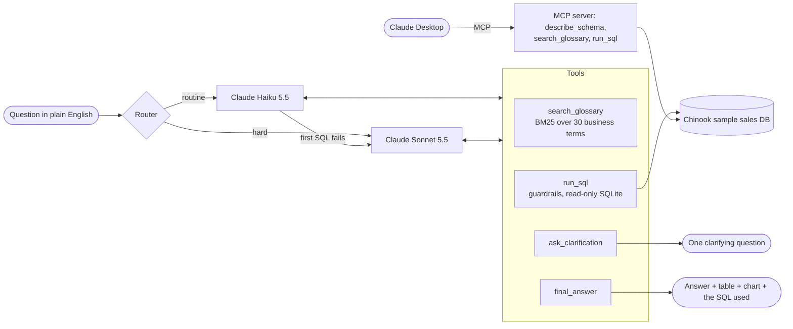

# ask-your-data-agent

Ask a sales database a question in plain English. The agent looks up business terms in a glossary, writes one read-only SQL query, runs it under guardrails, and answers with the numbers, a chart and the SQL it used. When a question is ambiguous ("Who is our best customer?"), it asks one clarifying question first.

Tested on 50 questions with Claude Haiku 5.5, Sonnet 5.5 and Opus 5.5, with accuracy, cost and latency measured for each.

## Results

Benchmark run on 2 Nov 2026: 50 questions per model, one run each.

| Model | Correct (of 50) | Clear questions (of 42) | Asked first on ambiguous questions (of 8) | Cost per question | Median latency |
|---|---|---|---|---|---|
| Claude Haiku 5.5 | **46 (92%)** | 42 | 4 | $0.0005 | 3.8 s |
| Claude Sonnet 5.5 | **46 (92%)** | 42 | 4 | $0.0085 | 5.0 s |
| Claude Opus 5.5 | **49 (98%)** | 42 | 7 | $0.0175 | 6.2 s |

What the numbers show:

- **SQL accuracy was not the difference.** With the glossary, the schema notes and the guardrails, all three models answered every clear question correctly (easy, medium and hard). Across 150 question runs, the `run_sql` tool never returned an error.
- **Judgement on vague questions was.** Opus asked a clarifying question on 7 of the 8 ambiguous questions; Haiku and Sonnet asked on 4. None asked when it didn't need to (0 of 42). When a model didn't ask, it picked a sensible reading and said which one; all 9 of those guesses matched the intended answer (corrected grader), but the benchmark counts them as misses.
- **Opus cost about 34 times as much as Haiku per question** ($0.0175 against $0.0005), and Haiku answered faster (median 3.8 s against 6.2 s). Per 1,000 questions: Haiku $0.52, Sonnet $8.45, Opus $17.47.
- **Prompt caching worked:** 91–92% of prompt tokens were read from cache.

The full tables, every miss and the method are in [docs/results.md](docs/results.md). Every API call is logged in [runs/costs.csv](runs/costs.csv): 417 paid calls, $1.32 for the smoke test and the benchmark together.

## The problem

Most business questions are a SQL query away, but the people asking them don't write SQL. An "ask your data" assistant has to get five things right at once:

1. **The SQL is correct.** A confident wrong number is worse than no answer.
2. **Business terms mean what the business says they mean.** "Active customer" and "last quarter" must follow the company's definitions, not the model's guess.
3. **It asks when a question is ambiguous.** "Who is our best customer?" has several right answers.
4. **It can't break anything.** Read-only, one query at a time, limited in rows and time.
5. **It's affordable and fast enough to use every day.**

This repo is a small, complete version of that assistant, plus a benchmark that measures all five.

## How it works



- **Tool use with prompt caching.** The instructions, schema and tool definitions (3,116 tokens on the first request) sit behind a cache breakpoint, and automatic caching covers the growing conversation, so each later step reads most of its prompt from cache.
- **Routing.** In the app, Haiku 5.5 answers by default. A keyword router sends hard questions (growth, shares, rankings inside groups) straight to Sonnet 5.5, and Haiku's attempt restarts on Sonnet 5.5 if its first SQL fails. The benchmark pins one model at a time, so the router was not part of it.
- **Guardrails.** One `SELECT` (or `WITH … SELECT`) per query, checked before it runs; a read-only connection (`mode=ro`, `PRAGMA query_only`); a SQLite authorizer that allows only reads; a 200-row limit (the model sees 50 rows); a 5-second timeout. Anything else is rejected and the model is told why.
- **Business glossary (RAG).** 30 definitions with SQL snippets, retrieved with BM25. For example, "active customer" means at least one invoice in the six months up to the data's last day.
- **MCP server.** The same tools for Claude Desktop. It needs no API key, because Claude Desktop is the model.
- **Web UI and CLI.** FastAPI with one HTML page, and an `askdata` command.
- **Spend controls.** Every call is logged with its model, tokens, cost and latency. Before each call, a worst-case check refuses anything that could push total spend past a set budget.

## How the benchmark works

- **Questions:** 50 in [bench/questions.json](bench/questions.json): 18 easy, 16 medium, 8 hard and 8 ambiguous, each with a gold SQL query. [bench/build_expected.py](bench/build_expected.py) computes the expected answers from the database.
- **Settings:** each model gets the same prompt, tools and settings: adaptive thinking, effort `medium`, up to 8 API calls per question.
- **Ambiguous questions:** the runner replies to a clarifying question with a scripted answer, such as "The customer with the highest total revenue, all time." A question counts as correct only if the model asked and then answered correctly.
- **Grading:** the agent's final SQL is re-run and its result compared with the gold result. Column names and order, extra columns and number formatting don't matter. Grading is deterministic and costs nothing.
- **Two scores.** "Strict" uses the rules fixed before the run. "Corrected" adds two rules, written after the run showed the strict rules marking two correct answers wrong (E12 and E17):
  - a single number also counts when it appears in the result and the answer states it;
  - extra rows whose numbers are all zero are ignored.

  Both scores come from the same stored SQL ([bench/regrade.py](bench/regrade.py)). Only Haiku's score changed, from 44 to 46.
- **Latency:** wall-clock time per question, including tool calls, measured from a cloud container with questions run one at a time.
- **Prices:** from Anthropic's pricing page on 2 Nov 2026 ([docs/pricing-2026-11-02.md](docs/pricing-2026-11-02.md)).

## Run it

Python 3.11+.

```bash
python -m venv .venv && . .venv/bin/activate
pip install -e ".[dev]"
pytest
```

Free commands (no API key needed):

```bash
askdata sql "SELECT BillingCountry, ROUND(SUM(Total), 2) AS revenue FROM Invoice GROUP BY 1 ORDER BY 2 DESC LIMIT 5"
askdata glossary "active customer"
python -m bench.run_bench --dry-run
```

Questions in plain English call the Claude API. Put your key in the `ASKDATA_ANTHROPIC_KEY` environment variable (the app reads no other variable), then:

```bash
askdata check-api   # free: checks the key reaches each model and counts prompt tokens
askdata ask "Which 5 countries brought in the most revenue in 2025?"
uvicorn askdata.web:app --port 8000   # then open http://localhost:8000
```

To reproduce the benchmark (about $1.32 at 2 Nov 2026 prices):

```bash
python -m bench.run_bench --models haiku,sonnet,opus --budget 5 --confirm-spend
python -m bench.regrade runs/bench/<run-id>
python -m bench.report runs/bench/<run-id> --out docs/results
```

### Claude Desktop (MCP)

Add this to `claude_desktop_config.json`, with the absolute path to your virtual environment:

```json
{
  "mcpServers": {
    "ask-your-data": { "command": "/absolute/path/to/.venv/bin/askdata-mcp" }
  }
}
```

## Data

The [Chinook sample database](https://github.com/lerocha/chinook-database): a digital music store's customers, invoices and catalogue, 2021–2025. MIT licence, copyright Luis Rocha; the notice is in [data/LICENSE-chinook.md](data/LICENSE-chinook.md). [scripts/build_db.py](scripts/build_db.py) rebuilds `data/chinook.sqlite` from the upstream file (checked by SHA-256) and removes the street address, postal code, phone, fax, email and birth-date columns.

## Limits

- **Small, clean data.** Chinook has 11 tables, 59 customers and 412 invoices. Real warehouses have more tables, messier names and missing values.
- **The questions and the glossary were written together**, by the same author, so every business term the questions use is defined. A real deployment needs its own glossary and test set.
- **One run per model.** Run-to-run variation was not measured, so treat small differences (such as 46 against 49) with care.
- **Clear questions hit the ceiling.** All three models scored 42 of 42, so this set doesn't separate them on SQL skill. Harder questions would.
- **Grading checks the result, not the writing.** The prose answer is checked only by the corrected rule for single numbers.
- **The router and escalation path were not benchmarked**; each model was tested on its own.
- **Latency depends on the network** and on API load at the time of the run.
- **The web UI is a demo.** It has no login, and conversations live in memory.

Design decisions and their reasons are in [DECISIONS.md](DECISIONS.md).

## Licence

MIT. See [LICENSE](LICENSE).
